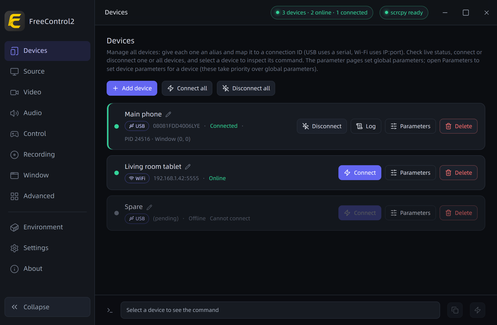
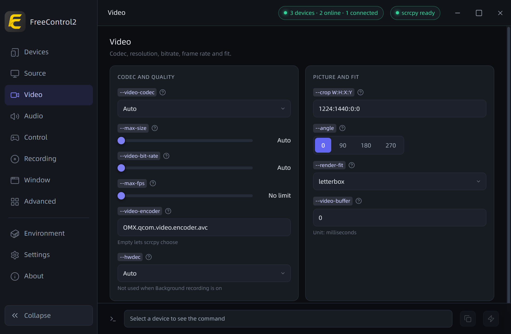
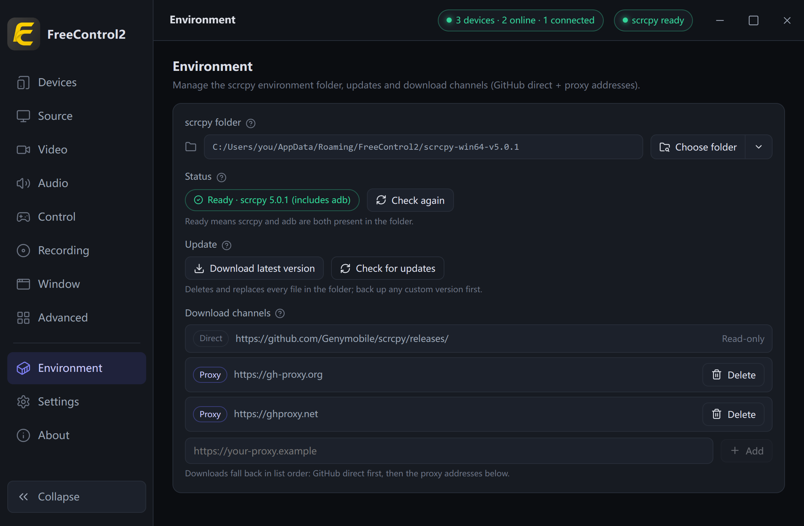
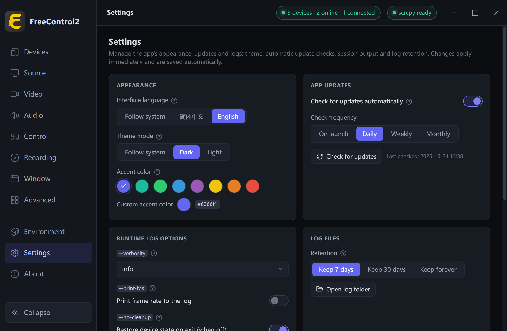

<p align="center">
  
</p>

<h1 align="center">FreeControl2</h1>

<p align="center">
  <a href="https://github.com/pdone/FreeControl2/actions/workflows/build.yml"></a>
  <a href="https://github.com/pdone/FreeControl2/releases/latest"></a>
  <a href="https://github.com/pdone/FreeControl2/releases"></a>
  <a href="https://github.com/pdone/FreeControl2"></a>
  <a href="https://github.com/pdone/FreeControl2/issues"></a>
  <a href="LICENSE"></a>
</p>

<p align="center">Control Android devices on PC</p>

<p align="center">
  <a href="README.md">中文</a> | English | <a href="https://freecontrol2.pages.dev/">Website</a>
</p>


## Features

- **Device list** — one alias per device, mapped to a USB serial or `IP:port`; add, rename and remove, with live online/connected status
- **Wireless pairing and discovery** — pair once with the on-device code, and list the devices on your network with wireless debugging on in one click
- **Parameter panels** — the common options of six groups as controls, each mapped to its scrcpy long option name; every field has a "?" detail, plus a custom-arguments box
- **Per-device overrides** — a device's own parameter set, switched on or off as a whole
- **Connection control** — connect or disconnect one device or all of them; several devices can mirror at once, with processes and output managed by the app
- **Runtime** — scrcpy and adb fetched on demand, channels tried in order and downloads verified against the official checksums; view the path, switch to an existing directory, check for updates
- **In-app updates** — check for and download a new version from "About", verify it and replace in place; portable builds restart to finish, and a startup check can be enabled
- **Logs** — per-session output persisted, kept for 7 days / 30 days / forever (the cards live on the Settings page)
- **Command preview** — the exact command about to run, shown at the bottom and copyable
- **Appearance** — light/dark themes and accent color, following the system by default, with a sidebar that collapses to an icon rail
- **Interface language** — switch the UI between Chinese and English on the Settings page, or follow the system

## Interface

**Devices** — device list and connection control:



**Parameters** — the common option controls:



**Runtime** — where scrcpy and adb are fetched:



**Settings** — appearance, interface language, updates and log settings:



## Quick Start

**To run**: Windows 10 / 11 (one portable single file each for x64 and ARM64) · the WebView2 runtime that ships with the system (usually preinstalled on 10 / 11; installable via Microsoft's Evergreen bootstrapper if missing) · an Android device with USB debugging enabled. Linux gets AppImage and deb; macOS 11 and later gets dmg (Safari 16.2 or newer).

Get the latest version from [Releases](https://github.com/pdone/FreeControl2/releases/latest): on Windows it is a single portable file — pick `FreeControl2_<version>_x64.exe` or `FreeControl2_<version>_arm64.exe` for your architecture and put it in any writable directory, with no installer; on Linux it ships as AppImage and deb release artifacts; on macOS it ships as dmg (one each for Apple silicon and Intel), which you open and drag the app into Applications.

If Gatekeeper blocks the first launch on macOS, clear it either way: open System Settings → Privacy & Security and click Open Anyway, or run `xattr -dr com.apple.quarantine /Applications/FreeControl2.app`.

1. **Get the runtime** — on first launch, go to the "Runtime" page and fetch scrcpy and adb.
2. **Add a device** — on the "Devices" page, add one: for USB, enter the serial listed by `adb devices`; for wireless, choose "Manual (IP:Port)" to enter the address, or use "Network scan" / "Pairing code" to discover and pair a device. You can set an optional alias for the device or for each scan result.
3. **Connect and mirror** — click "Connect" on the device card. Several devices can be connected at once; the command preview at the bottom shows the exact command being run.
4. From there you can adjust the defaults on the parameter pages, or give a single device its own override.

### Build from source

You additionally need Node.js 24 and npm · a stable Rust toolchain · the MSVC build tools on Windows, system libraries such as webkit2gtk on Linux, or the Xcode command-line tools on macOS (see `.github/workflows/build.yml` for the list).

```sh
npm install
```

Windows (single portable executable):

```sh
npm run app:build
```

The artifact is written to `src-tauri/target/release/FreeControl2.exe`.

Linux (AppImage and deb):

```sh
npm run tauri build -- --bundles appimage,deb
```

The artifacts are written to `src-tauri/target/release/bundle/`.

macOS (dmg):

```sh
npm run tauri build -- --bundles dmg
```

The artifact is written to `src-tauri/target/release/bundle/dmg/`. The macOS artifacts are ad-hoc signed and not notarized, so the first launch needs the clearance described above.

When you trigger `.github/workflows/build.yml` manually, the artifacts are collected into a **draft release** (never published automatically). If the same version has already been published, re-running a build will not overwrite it: the artifacts land in a `v<version>-draft` pickup draft instead — that draft only exists to retrieve artifacts and is **never published**.

### Local development

```sh
npm install
npm run app:dev
```

That one command starts the whole app, with the frontend dev server brought up by the build config (`beforeDevCommand` in `src-tauri/tauri.conf.json`; the UI runs at `http://localhost:1420`). The common commands are registered as editor tasks in `.vscode/tasks.json`, so you can also just pick them by name from the task list.

## Project Structure

```
FreeControl2/
├─ src/                    Frontend (Svelte + Vite + TypeScript)
│  ├─ components/          UI components (devices, parameter pages, settings and logs, runtime, about dialog…)
│  └─ lib/                 Frontend logic (parameter model, command building, validation, config)
├─ src-tauri/              Backend (Rust + Tauri 2)
│  ├─ src/                 Command layer and platform code (device, scrcpy, config, assets, download, session, logging)
│  └─ tauri.conf.json      App and bundling config — the single source of the version number
├─ assets/icons/           Brand asset package (single source, with the icon build pipeline and its docs)
├─ scripts/                Icon sync script (mirrors the bundling manifest into src-tauri/icons/)
├─ .vscode/                Editor task entries (they only reference the script names in package.json)
├─ ui-design/              UI baseline prototype (read-only reference)
├─ openspec/               Specs and change artifacts
└─ Update.md               Changelog
```

## FAQ

### A device will not connect

**USB** — make sure the device has "Developer options" and "USB debugging" enabled, the cable is intact, the driver is fine on Windows (no yellow warning in Device Manager), and `adb devices` lists it. If "Developer options" is missing, tap "Build number" seven times in "Settings" - "About phone".

**Wireless** — in "Add device", choose "Network scan" or "Pairing code"; you can also choose "Manual (IP:Port)" to enter the connection address directly. On Android 11 and above, tap "Pair device with pairing code" in the device's "Wireless debugging"; the app finds the device and fills in the pairing address (pick one if several are found), so you only enter the 6-digit code. If nothing is found, enter the pairing address manually. The app then resolves the connection port and connects. You can set an optional alias for the device or for each scan result while adding, so there is no need to rename it on the device card. The port changes when the device restarts or wireless debugging is toggled, so click "Resolve port again" on the device card when it shows as offline. Devices still using `adb tcpip 5555` are found by the scan, or you can enter `IP:port` yourself. The device and the computer must be on the same network.

### It says scrcpy or adb is missing

Fetch them on the "Runtime" page. Neither ships with the app; both are downloaded into the application data directory on demand, or you can point that page at an existing custom directory.

### How do I update to a new version

Open "About" and click "Check for updates", or turn on "Check for updates automatically" on the "Settings" page — the app downloads and verifies the new version, then restarts to finish. On Linux the package build is handed to the system installer once downloaded. On macOS the dmg is downloaded and verified, then opened by Finder so you can drag the app into Applications over the old version; the app does not quit on its own.

### The download fails or hangs on one channel

A failed direct connection falls back to the next channel; you can also switch channels in place from the progress area. Channels that cannot be reached are skipped for the rest of the run instead of retried.

### The window is blank after launch on Windows

Make sure the WebView2 runtime is installed (usually included with Windows 10 / 11).

### The window stops updating after launch on Linux

On setups such as virtual machines, software rendering or remote sessions, the window may draw its first frame and then stop updating (clicks still take effect). The app detects this at launch and avoids that rendering path on its own, so most such setups need nothing from you; if you still hit it, start the app with `WEBKIT_DISABLE_DMABUF_RENDERER=1 FreeControl2` — the detection is heuristic, so some setups fall through.

### Where does the data live

All of it is under the application data root (`%APPDATA%/FreeControl2` on Windows, a directory of the same name under the XDG data root on Linux, `~/Library/Application Support/FreeControl2` on macOS):

| Path | Purpose |
|---|---|
| `config.json` | The single configuration file (with a `schemaVersion`): device list, default parameters, per-device overrides, log retention |
| `logs/yyyy-MM-dd.log` | Persisted session output and key actions of the app itself |
| `scrcpy-{OS}-v{version}/` | The scrcpy and adb runtime downloaded on demand (when no custom directory is set) |

Everything you can change in the UI lands in `config.json`.

### How do I reset to the factory defaults

Delete `config.json` and start the app again: the device list, the parameters and the retention policy all go back to their factory values.

### Where are the logs

The "Settings" page has a one-click shortcut to the log directory; the files live under `logs/` in the application data root and are named by date.

### adb is still running after I quit the app

That is intentional: quitting does not stop the adb server, so wireless connections survive the exit and are reused on the next launch.

## License

[MIT](LICENSE)

## Acknowledgements

- [scrcpy](https://github.com/Genymobile/scrcpy) — mirroring and device control are entirely its doing; this project is a shell around it.
- [Tauri](https://tauri.app/), [Svelte](https://svelte.dev/), [Vite](https://vite.dev/), [lucide](https://lucide.dev/) — the app shell and UI.
- [FreeControl](https://github.com/pdone/FreeControl), its predecessor — this project is a rework built on the interaction lessons from it.
